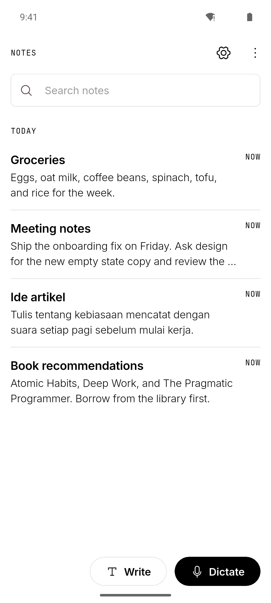

# noteit!

An Android notes app with voice dictation. You speak, and the transcript is added to a note or
typed into whichever app is open. Transcription uses the Gemini API by default, with an optional
on-device Whisper model that works offline.

<p align="center">
  
</p>

## Features

- Create and edit notes with a title and body. Edits save automatically.
- Browse notes as a list or a grid, grouped by date, sorted by last edit, creation time or title.
- Search note titles and bodies.
- Delete a note and undo the deletion.
- Dictate into the open note with the **Dictate** button.
- Dictate into other apps through a floating microphone bubble. The text is inserted into the
  focused text field by an Android accessibility service, or copied to the clipboard if that
  service is turned off.
- Choose the transcription engine: Gemini (cloud) or Whisper Small (on-device, about 190 MB,
  downloaded once and checked against its SHA-256 hash).
- Keep a failed recording. You can retry it, run it with the local engine, or discard it. The
  app never switches engines on its own.
- Add vocabulary words to improve recognition of names and terms.
- Add autocorrect rules that replace one word or phrase with another in every transcript.
- Recover from crashes. A recording in progress survives an app restart and can be retried.
- Light and dark themes that follow the system setting.

## Architecture

The app has two layers that talk over a Flutter `MethodChannel`.

```
┌───────────────────────── Flutter (Dart) ─────────────────────────┐
│ Screens ── NotesProvider ── NotesRepository ── SQLite (notes.db)  │
│    │       SettingsService ── SharedPreferences                   │
│    │       SpeechService / OverlayBridge                          │
└────┼──────────────────────────────────────────────────────────────┘
     │ MethodChannel
┌────▼──────────────────── Android (Kotlin) ───────────────────────┐
│ MainActivity ── DictationCoordinator ── session journal (files)   │
│                    │          │                                   │
│              AudioCapture   GeminiTranscriber ── Gemini API       │
│                    │        LocalPipeline ── WhisperEngine        │
│ OverlayService (bubble)                         │ JNI              │
│ InsertionService (accessibility)          whisper.cpp (C/C++)     │
└───────────────────────────────────────────────────────────────────┘
```

The Dart layer owns the notes and the settings. The Kotlin layer owns everything that must keep
running when no app screen is open: the microphone, transcription, the floating bubble, and text
insertion into other apps.

### Main components

| Component | Layer | Responsibility |
|---|---|---|
| `NotesRepository` | Dart | Stores notes in SQLite. Records which dictation session wrote to which note, so a transcript is never appended twice. |
| `NotesProvider` | Dart | Holds the list shown on screen, search, sort and Undo state. |
| `SettingsService` | Dart | Engine choice, vocabulary, autocorrect rules and display settings. |
| `SpeechService` | Dart | Starts and stops dictation for a note and reacts to session updates. |
| `OverlayBridge` | Dart | The `MethodChannel` calls into Kotlin. |
| `DictationCoordinator` | Kotlin | One state machine per recording: start, stop, retry, discard, deliver. Writes the session journal. |
| `AudioCapture` | Kotlin | Records 16 kHz mono 16-bit audio to a WAV file. |
| `GeminiTranscriber` | Kotlin | Uploads the WAV and requests a transcript from Gemini. Cancellable. |
| `LocalPipeline` and `WhisperEngine` | Kotlin + C | Splits audio at pauses and transcribes each chunk with whisper.cpp while you are still speaking. |
| `ModelStore` | Kotlin | Downloads Whisper models from Hugging Face and verifies size and SHA-256. |
| `PersonalAutocorrect` | Kotlin | Applies the user's autocorrect rules to every transcript. |
| `OverlayService` | Kotlin | The floating microphone bubble. A foreground service with the microphone type. |
| `InsertionService` | Kotlin | Accessibility service that inserts text into the focused field of another app. |

## Voice transcription and journal write flow

Each recording is a session with its own WAV file and a small JSON journal in the app's private
storage. The journal stores the session state, so the app knows what to do after a crash.

1. **Start.** You tap the bubble or **Dictate**. The coordinator creates a session and writes the
   journal with state `recording`. The microphone starts writing the WAV file.
2. **Record.** With the local engine, audio is also split at pauses and transcribed chunk by chunk
   during recording. With Gemini, audio is only written to the file.
3. **Stop.** The state becomes `processing` and the journal is written again.
4. **Transcribe.** Gemini receives the whole file, or the local pipeline finishes its last chunk.
   Autocorrect rules are then applied.
5. **Complete.** The text is stored in the journal with state `completed`.
6. **Deliver.** For a note, the text is appended together with a receipt keyed by the session id
   in one database transaction. For another app, the journal first records that insertion was
   attempted, and only then is the text inserted.
7. **Finish.** After delivery the session is marked `delivered`, and its journal and audio file
   are deleted.

If transcription fails, the state becomes `failed` and the audio is kept for Retry, Use local or
Discard. Discard marks the session `cancelled` and deletes its files.

Every journal write follows the same pattern. The new state is written to a temporary file,
flushed to disk with `fsync`, and then renamed over the old journal. A crash therefore leaves
either the old state or the new one, never a half-written file.

On the next launch the coordinator reads every journal:

| Journal state at crash | Result after restart |
|---|---|
| `recording` or `processing` | Shown as failed with "Recording interrupted". The WAV header is repaired so the audio can be retried. |
| `completed` | The transcript is offered again for delivery. |
| `completed`, insertion into another app attempted | The transcript is offered for copying instead of being inserted again. |
| `delivered` or `cancelled` | Remaining files are deleted. |

## Tech stack

| Area | Technology |
|---|---|
| UI and app logic | Flutter 3.44, Dart 3.12, Provider |
| Local storage | SQLite through `sqflite`, `shared_preferences` |
| Native layer | Kotlin, Android SDK 36 (minimum API 24), ARM64 only |
| On-device speech recognition | whisper.cpp (pinned commit, built from source with CMake and the NDK), Whisper Small Q5_1 |
| Cloud speech recognition | Gemini API, model `gemini-3.5-transcribe` |
| Build | Gradle 9.1, Android Gradle Plugin 9.0, CMake 3.22, JDK 17 |
| Tests | `flutter_test`, JUnit (Kotlin), Python `unittest` for evaluation scripts |

## Project structure

```
.
├── docs/
│   ├── DESIGN.MD                    design system: colours, type, components
│   ├── mobile-implementation-plan.md
│   └── screenshots/
└── mobile/
    ├── lib/
    │   ├── main.dart
    │   ├── data/                    NotesRepository, NotesProvider
    │   ├── models/                  Note, engine and dictation session types
    │   ├── screens/                 notes list, editor, settings, vocabulary, bubble setup
    │   ├── services/                settings, speech, MethodChannel bridge
    │   └── theme/                   design tokens and shared widgets
    ├── test/                        Dart unit and widget tests
    ├── integration_test/            on-device tests (isolated benchmark package)
    ├── android/
    │   └── app/src/
    │       ├── main/kotlin/         coordinator, audio, transcribers, bubble, insertion
    │       ├── main/cpp/            JNI bridge and whisper.cpp build
    │       ├── test/                Kotlin unit tests
    │       ├── punctuationBenchmark/  experimental, not in normal builds
    │       └── qwenBenchmark/         experimental, not in normal builds
    ├── scripts/                     Python evaluation and benchmark tools
    ├── docs/                        release notes, evaluation records, setup guides
    └── assets/                      fonts and app icon
```

## Dependencies

**Dart packages**

| Package | Purpose |
|---|---|
| `provider` | State management |
| `sqflite`, `path` | Note storage |
| `shared_preferences` | Settings storage |
| `permission_handler` | Microphone, notification and overlay permissions |
| `phosphor_icons` | Icons |

Development only: `flutter_test`, `integration_test`, `flutter_lints`, `sqflite_common_ffi`
(runs the database tests on a desktop), `flutter_launcher_icons`.

**Native**

- whisper.cpp, fetched by CMake at a pinned commit and patched at build time.
- `org.json` and JUnit for Kotlin unit tests.

**External services**

- Gemini API key, needed for the Gemini engine. The local engine works without it.
- Hugging Face, used once to download the Whisper model.

**Optional tooling**

- Python 3.9 or newer for the scripts in `mobile/scripts`. The experimental punctuation screen
  also needs the packages in `mobile/scripts/requirements-punctuation.txt`.

**Bundled fonts**

- Inter and JetBrains Mono, under the SIL Open Font License. The license files are in
  `mobile/assets/fonts`.

## Installation

noteit! runs on Android 7.0 (API 24) or newer on ARM64 devices. There is no prebuilt public
release, so you build the APK yourself on Windows or Linux and install it on your phone.

### Requirements for building

- Flutter 3.44.2. It includes Dart 3.12.
- JDK 17.
- Android SDK with platform 36, build tools, CMake 3.22.1, and the NDK. Gradle installs the NDK
  automatically on the first build.
- Git, which CMake uses to fetch whisper.cpp.
- About 6 GB of free disk space.

### Gemini key (optional)

Copy `mobile/android/secrets.properties.example` to `mobile/android/secrets.properties` and set
`GEMINI_API_KEY`. The file is ignored by Git. The key is compiled into the APK and can be
extracted from it, so do not share an APK built with your key.

Without a key the app builds and runs. Only the local engine will transcribe.

### Windows

```powershell
winget install Microsoft.OpenJDK.17
winget install Git.Git
# Download Flutter 3.44.2 from https://docs.flutter.dev/release/archive and extract it to C:\src\flutter
# Install Android Studio, or the Android command-line tools, then:
sdkmanager "platform-tools" "platforms;android-36" "build-tools;36.0.0" "cmake;3.22.1"

$env:Path = "C:\src\flutter\bin;$env:Path"
flutter doctor --android-licenses

git clone https://github.com/andhikalucas/noteit.git
cd noteit\mobile
flutter pub get
flutter build apk --release --target-platform android-arm64
```

The APK is written to `mobile\build\app\outputs\flutter-apk\app-release.apk`.

### Linux

```sh
sudo apt install openjdk-17-jdk git curl unzip xz-utils   # or your distribution's equivalent
curl -LO https://storage.googleapis.com/flutter_infra_release/releases/stable/linux/flutter_linux_3.44.2-stable.tar.xz
tar -xf flutter_linux_3.44.2-stable.tar.xz -C "$HOME"
export PATH="$HOME/flutter/bin:$PATH"
# Install Android Studio, or the Android command-line tools, then:
sdkmanager "platform-tools" "platforms;android-36" "build-tools;36.0.0" "cmake;3.22.1"
flutter doctor --android-licenses

git clone https://github.com/andhikalucas/noteit.git
cd noteit/mobile
flutter pub get
flutter build apk --release --target-platform android-arm64
```

The APK is written to `mobile/build/app/outputs/flutter-apk/app-release.apk`.

### Android

Install the APK you built using one of these methods.

- **With USB.** Turn on USB debugging in the phone's developer options, connect the phone, and run:

  ```sh
  adb install -r mobile/build/app/outputs/flutter-apk/app-release.apk
  ```

  The `-r` flag updates an existing install and keeps your notes.
- **Without a computer.** Copy the APK to the phone, open it in a file manager, and allow the file
  manager to install unknown apps when Android asks.

After the first launch:

1. Allow microphone access when you first tap **Dictate**.
2. To use the floating bubble, open Settings and follow the bubble setup. It asks for permission
   to display over other apps. Turning on the noteit! accessibility service is optional. Without
   it, the transcript is copied to the clipboard for you to paste.
3. To use the local engine, choose it in Settings and download the model.

The release build is signed with the Android debug key. Keep using the same key for updates, or
Android will refuse to install over the existing app.

### iPhone

Not supported. The project contains no iOS app, and the floating bubble and cross-app text
insertion depend on Android APIs that iOS does not offer.

## Development

```sh
cd mobile
flutter analyze
flutter test
python -m unittest discover -s scripts -p "test_*.py"
cd android && ./gradlew :app:testDebugUnitTest
```

Integration tests in `mobile/integration_test` run on a device under a separate package name, so
they never touch the data of an installed copy of the app.

## Author

GitHub: [@andhikalucas](https://github.com/andhikalucas)
